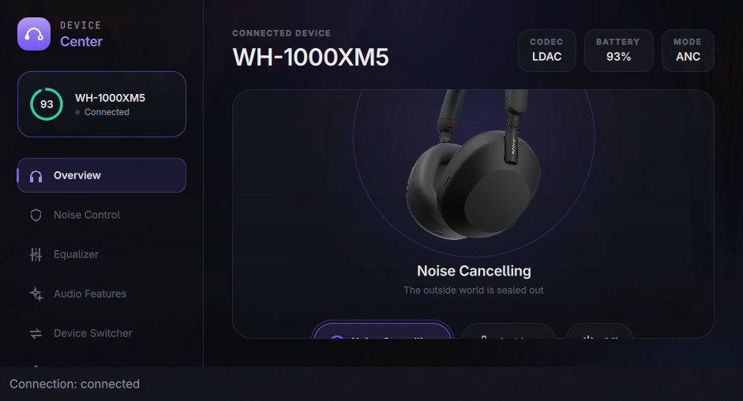

# WH-1000XM5 on Omarchy / Arch Linux

This fork keeps the original Sony Device Center GUI, CLI, and Bluetooth protocol
implementation. It adds two small fixes validated on a physical WH-1000XM5.
Credit for the application and protocol work belongs to the
[upstream project](https://github.com/marconvcm/sony-device-center) and its
contributors. The existing [MIT license](../LICENSE) is retained.

## Fixes in this fork

### Switching from ANC to Ambient Sound

The headset reports Ambient level zero while ANC or Off is active. The GUI used
to overwrite its selected level with zero and then submit that invalid value
when Ambient Sound was clicked. It now retains the last valid level (1–20),
using its existing default of 10 until a valid Ambient reading is available.
A regression test covers startup in ANC, the Ambient action, and preserving
the selected level through ANC and Off notifications.

### Unsupported Adaptive Volume Control

The upstream WH-1000XM5 profile advertised Adaptive Volume Control as supported.
[Sony's compatibility table](https://helpguide.sony.net/mdr/hpc/v1/en/contents/TP0001548861.html)
marks it unavailable for this model. On firmware 2.5.1, repeated read-only
`f6 0a` queries received transport acknowledgements but no setting response,
while supported settings continued to return data.

The XM5 profile now disables this capability, preventing the repeated queries
and marking the GUI control unsupported. Increasing the timeout would not add
the missing feature. **Adaptive Sound Control** is a separate Sony function;
this change does not implement its phone-side automation.

## Build

The tested setup was Omarchy 4.0.4 on x86_64, GCC 16.2.1, Qt 6.11.2,
CMake 4.4.3, Ninja 1.13.2, and Catch2 3.16.0. Other versions are not certified by
this fork's hardware testing. Package versions and availability may change.

Install the build dependencies using the normal package-management process for
your Arch-based system. On an already up-to-date system:

```sh
sudo pacman -S --needed gcc make cmake ninja git pkgconf bluez-libs dbus glfw \
  qt6-base qt6-declarative catch2
git clone --recurse-submodules https://github.com/ChipGillespie/sony-device-center.git
cd sony-device-center
cmake -S . -B build -G Ninja -DCMAKE_BUILD_TYPE=Release \
  -DBUILD_TESTING=ON -DSONY_REQUIRE_QT=ON
cmake --build build --parallel 4
ctest --test-dir build --output-on-failure --no-tests=error --parallel 4
```

`SONY_REQUIRE_QT=ON` ensures configuration fails if the GUI cannot be built.
The build also configures the bundled legacy client, which requires GLFW and
the ImGui submodule even when you intend to use the Qt application.

## Run

Pair and connect the headphones through your normal Bluetooth controls, then:

```sh
./build/apps/device-center/sony-device-center
```

The GUI opens its own Bluetooth control connection if no `sonyd` is running.
No kernel driver, root access for the app, or always-running service was needed
on the tested machine. Keep the window large enough to see the controls.

Close the GUI before opening a direct CLI session:

```sh
./build/apps/sonyctl/sonyctl --direct info
```

Only one application should own the Sony control connection at a time. If the
phone app or another controller is connected, close its control session before
diagnosing a connection failure. For shared GUI/CLI access, see the upstream
[daemon and IPC documentation](ipc-and-lifecycle.md).

## Optional user-local installation

After a successful build, copy the three binaries into your user account:

```sh
install -Dm755 build/apps/device-center/sony-device-center "$HOME/.local/bin/sony-device-center"
install -Dm755 build/apps/sonyctl/sonyctl "$HOME/.local/bin/sonyctl"
install -Dm755 build/apps/sonyd/sonyd "$HOME/.local/bin/sonyd"
```

Close an older running instance before replacing its installed binary. Launch
with `~/.local/bin/sony-device-center`. These commands do not enable autostart or
a background service. The installed binaries still depend on your system's Qt,
BlueZ, and D-Bus libraries; they are not portable standalone downloads.

## Hardware validation

Tested on 2026-10-16 with WH-1000XM5 firmware 2.5.1, using both a direct GUI
session and temporary daemon IPC. Results apply to this model and firmware.

| Behavior | Result |
| --- | --- |
| Discovery and connection | Passed |
| Battery, firmware, and codec | Valid readings; LDAC reported |
| ANC and Ambient Sound level 10 | Fresh device readback confirmed both transitions; listener confirmed the audible change |
| Restore original ANC mode | Passed |
| EQ, DSEE, Speak-to-Chat, auto-power-off reads | Valid readings |
| Adaptive Volume after correction | Unsupported; no `f6 0a` queries sent; supported readings still valid |
| Automated checks | All 137 CTest cases passed, including the GUI regression and simulated startup |

EQ writes, DSEE writes, other advanced setting writes, firmware updates,
power-cycle/reconnect behavior, and other models were not validated in this
session. The GUI is not a verified replacement for Sony's firmware-update flow.
Readback success and a transport ACK alone do not prove an audible effect.



This cropped screenshot shows the real device session. The other screenshots in
the upstream README were captured using the simulator. Private Bluetooth
addresses, diagnostic logs, backups, and machine-specific setup notes are not
included in this fork's published changes.

## Remove the user-local installation

Close the GUI and remove the three binaries listed in the installation section.
If you separately installed a desktop entry or icons, remove those copies too.
Keep or remove your source checkout independently. No system service was enabled
by the installation commands above.
